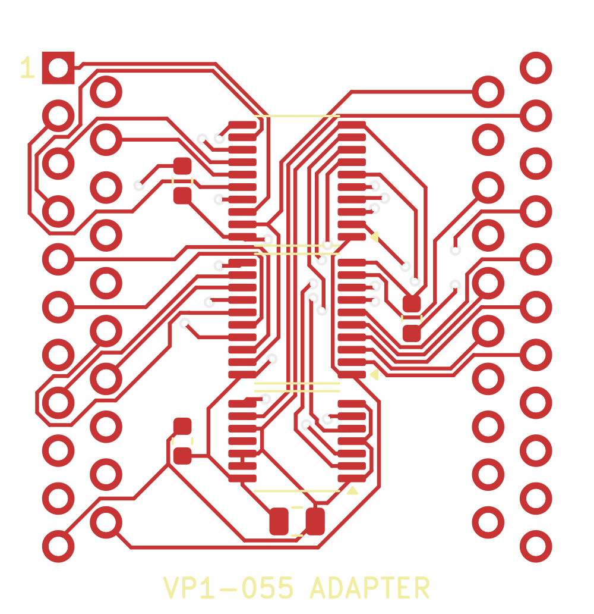
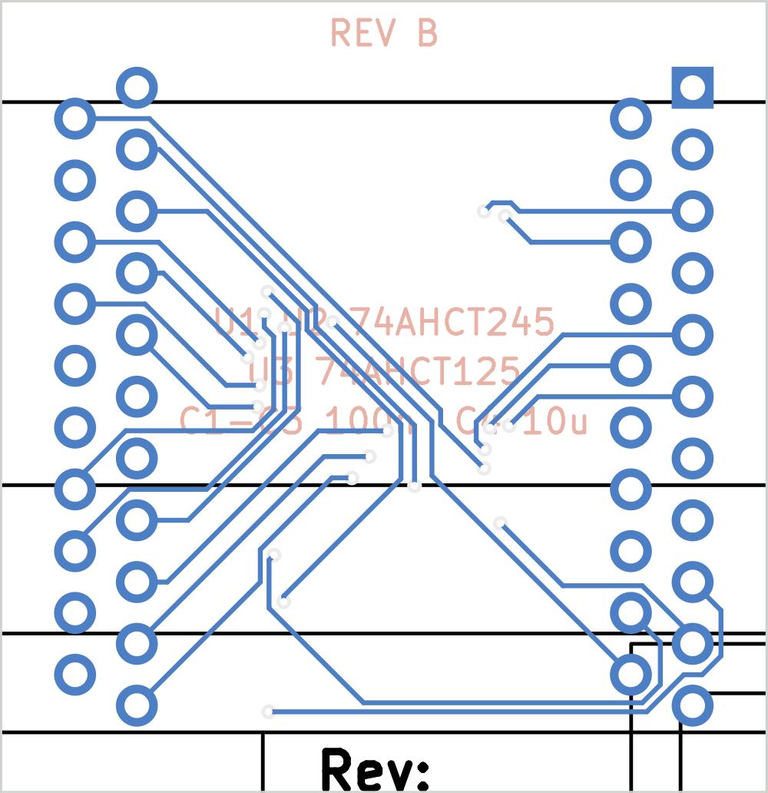

# The adapter board

A 31 × 32 mm two-layer board that plugs into the socketed D22 site and carries
the substitute: two 74AHCT245 for the sixteen bidirectional lines, one
74AHCT125 for C0–C2 → A0–A2, decoupling, and underneath a field of 42 pins in
the original package's pattern. No glue logic — pin 20 goes straight to the
'245s' DIR (its sense already matches: high = nA drives V/W) and pin 41 to
their /OE. The logic is the one proven equivalent in `sim/`.

 

`vp1-055-adapter-gerbers.zip` is the fab package (two layers, 0.2 mm tracks,
0.15 mm clearance, 0.6/0.3 mm vias — any prototype fab). `adapter_routed.kicad_pcb`
is the routed board: 384 segments, 26 vias, every connection routed, DRC clean.

## The site, as measured

The КР1801ВП1 package is through-hole, 42 pins in **four staggered rows**:

| | |
|---|---|
| pitch within a row | 2.5 mm |
| consecutive pin numbers along a side | 1.25 mm (they alternate rows) |
| inner row to outer row, same side | 2.5 mm |
| outer row to outer row | 25.0 mm |
| pins | 0.5 mm square; standard machined receptacles fit |
| numbering | pin 1 at the dimple corner, **outer** row; down the left side, up the right (DIP order); 11 outer + 10 inner pins per side |

Measured on the MS 0511 board in September 2026. If a different board or
package revision disagrees, the numbers live in one dictionary at the top of
`build_adapter.py`.

## Parts

Also as [`BOM.csv`](BOM.csv), with quantities, DigiKey and Mouser numbers
and the 42 socket receptacles for the machine side.

| ref | part | package |
|---|---|---|
| U1, U2 | 74AHCT245 (SN74AHCT245PWR) | TSSOP-20 |
| U3 | 74AHCT125 (SN74AHCT125PWR) | TSSOP-14 |
| C1–C3 | 100 nF | 0603 |
| C4 | 10 µF | 0805 |
| J1 | 42 PCB pins, Ø0.51 mm with a 1.17 mm flange (Mill-Max 3128-1-00-21-00-00-08-0) | single pins, soldered from the top |
| socket | 42 receptacles for Ø0.46–0.51 mm pins in a 1.0–1.1 mm hole (Harwin H3153-01) | one per hole on the MS 0511 |

The pin and the receptacle are a matched pair: the H3153-01 is specified for
0.46–0.51 mm pins and the 3128 pin is 0.51 mm. Ordinary machined-pin header
strips are *not* a safe substitute unless measured — Mill-Max's 2.54 mm
headers have 0.61 mm tails and their 1.27 mm headers 0.43 mm, both outside
the receptacle's range. The receptacle needs a 1.0–1.1 mm hole on the
machine; check the site with a 1.0 mm drill shank before ordering.

TSSOP because that is what fits inside the site outline; SOIC would need the
board to overhang the chip ends by ~10 mm, and the D22 neighbourhood is
crowded. 0.65 mm pitch hand-solders fine with flux and a drag.

Use **AHCT**, not HC/HCT or AC: TTL-level inputs (the bus and the ВМ2 are
TTL-compatible), and the speed is in the same band as the original — see
`docs/DESIGN.md` for the timing comparison.

## Building the files

```
./run.sh          # KiCad 7 python, kicad-cli, Java, freerouting.jar, xvfb-run
```

`build_adapter.py` writes the board from the geometry and the netlist;
Freerouting routes it; `finish_adapter.py` imports the routes (parsing the
session file itself — pcbnew's importer only works inside the GUI), runs DRC
and saves; `kicad-cli` exports gerbers and drill. The zip is what goes to the
fab; the routed `.kicad_pcb` is there for anyone who wants to look or move
things.

## Assembly

1. Fit the socket on the machine first: one machined receptacle per hole, 42
   of them (singles, not strips — strips are 2.54 mm and drift off the 2.5 mm
   holes within a row).
2. Solder the SMD parts on the top of the adapter.
3. Push the 42 pins through the adapter from the top, **long (6.35 mm) end
   down**: the flange stops on the top pad and is soldered there, the short
   2.5 mm stub stays above the board. Use the socketed site as the jig (pins
   plugged into the receptacles first, adapter lowered onto them, then
   soldered) so they stay straight; then trim the pins to ~3.5 mm below the
   board, which is what the receptacle takes.
4. Plug in with the pin-1 corner (square pad, marked on the silk) at the
   dimple corner of the site.

## Acceptance test

Boot FODOS and run the canary (`diag/canary` in onerom-1801re2) on a warm
machine for twenty minutes: the bell keeps ticking and the log is clean. That
is the exact failure the original chip had, so it is the exact test.
